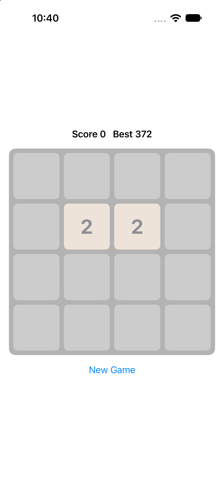
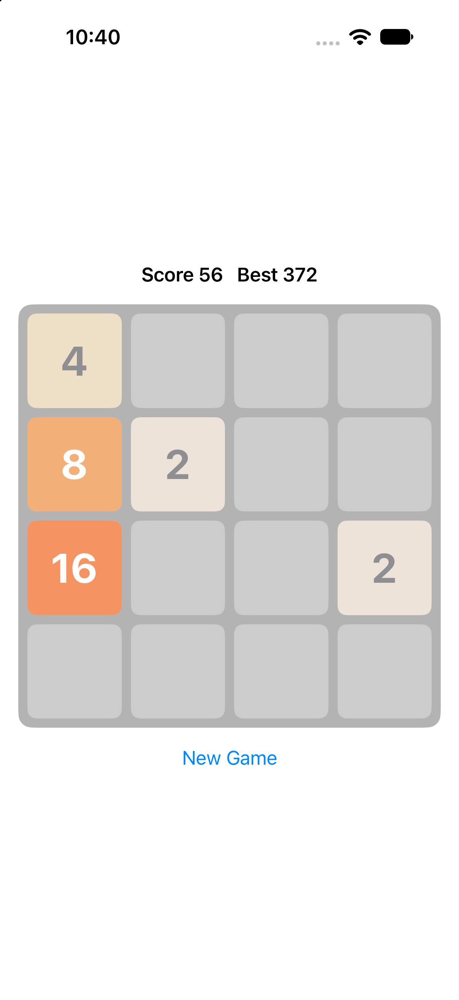

# 2048

A SwiftUI implementation of the classic 2048 sliding-tile puzzle for iOS. Swipe to slide every tile on the board, merge matching numbers, and try to build the highest tile you can.

## Screenshots

  
  

## Features

- 4×4 board controlled by swipe gestures (up, down, left, right)
- Two-phase animation: tiles slide, then merge and a new tile spawns
- Live score and a persistent best score (saved with `@AppStorage`)
- Game-over detection with a "Try again" alert
- New Game button that safely cancels any animation in progress
- Tile colors for 2 up to 2048 and beyond

## Requirements

- Xcode 16 or later
- iOS 17 or later (uses the `#Preview` macro and modern SwiftUI APIs)

## Getting Started

1. Open `2048.xcodeproj` in Xcode.
2. Select an iPhone simulator or a connected device.
3. Press **Cmd+R** to build and run.

## How to Play

- Swipe in any direction to slide all tiles that way.
- When two tiles with the same number collide, they merge into one tile with double the value, and that value is added to your score.
- After each valid move, a new tile (2 with 90% chance, 4 with 10%) appears in a random empty cell.
- The game ends when the board is full and no neighboring tiles can merge.

## Project Structure

| File | Contents |
| --- | --- |
| `ContentView.swift` | The whole game: `Tile`, `Direction`, `GameModel`, `TileView`, `GameView`, `ContentView` |
| `_048App.swift` | The `@main` app entry point that shows `ContentView` |

### How the code fits together

- **`Tile`** is an identifiable value with a number and a row/column position. Its stable `id` lets SwiftUI animate each tile from one cell to another.
- **`GameModel`** is an `ObservableObject` that owns the tiles, the score and the game-over flag. `move(_:)` computes the whole move in one pass over four lines, then commits it once: slide, then merge and spawn after 0.12 seconds. A `busy` flag blocks input during the animation, and a `generation` counter discards stale animation callbacks after a reset.
- **`GameView`** draws the board in a `ZStack`, positions tiles with offsets and turns drag gestures into moves.
- **`TileView`** renders a single colored, numbered tile.

## Resetting the Best Score

The best score is stored in `UserDefaults` under the key `best`. To clear it, delete the app from the simulator or device, or temporarily set `best = 0` in `GameView.onAppear`.

## Ideas for Improvement

- "You win" message when a 2048 tile appears, with an option to keep playing
- Undo last move
- Haptic feedback on merges
- Keyboard and arrow-key support for iPad and Mac
- Unit tests for `GameModel` (merge rules, no double merges, game-over detection)
